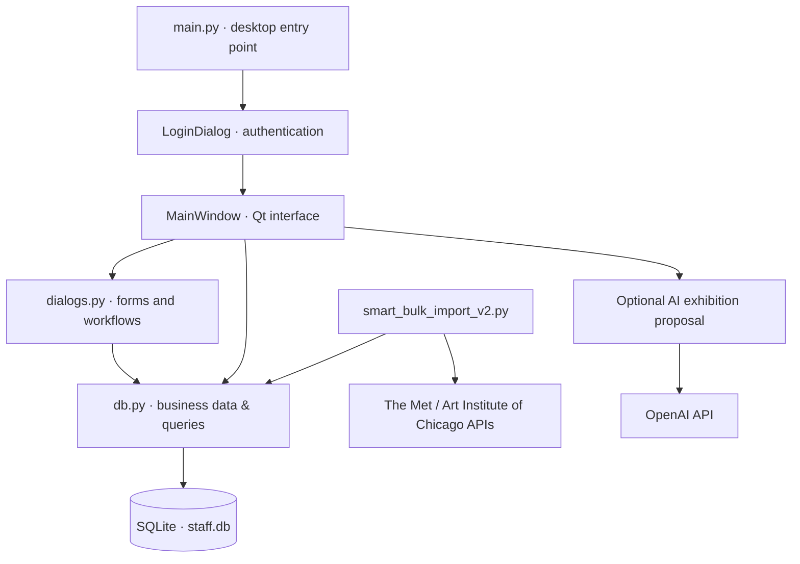

# ArtFlow — Art Gallery Management System

**A desktop application for organizing art collections, exhibitions, and gallery operations.**


ArtFlow is a **Python desktop gallery-management project** built with **PySide6 (Qt)** and **SQLite**. It brings together collection administration, exhibition planning, visitor services, and reporting in one graphical interface. It also includes an optional **AI-assisted exhibition proposal** feature and a separate museum-data import utility.

> **Scope:** University team coursework (Team 13), presented here as a software-engineering portfolio project. This is a demonstration/academic implementation, **not a production-ready gallery platform**.

## Highlights

| Area | Capabilities |
| --- | --- |
| **Collection management** | Catalog artworks, artists, and gallery rooms; maintain artwork information and placements |
| **Exhibitions** | Create, edit, and manage exhibitions; associate artworks and curatorial information |
| **Gallery operations** | Track staff, artwork loans, maintenance, and conservation work |
| **Visitor services** | Manage tour sessions/bookings and ticket types, sales, and check-in workflows |
| **Dashboard** | View a calendar of upcoming activities and reporting/analytics, including ticket revenue charts |
| **AI-assisted curation** | Generate a proposed exhibition from existing artworks via the OpenAI API, review it in the UI, and optionally save it |
| **Artwork import** | Import public-domain artwork metadata and images from the Metropolitan Museum of Art and Art Institute of Chicago APIs |

The optional AI feature **proposes**, rather than autonomously publishes, an exhibition: the user reviews and accepts the generated proposal in a dialog.

## Tech stack

- **Application/UI:** Python, PySide6 / Qt, Qt Designer UI definitions
- **Persistence:** SQLite; schema initialization, migrations, and CRUD functions in `db.py`
- **Analytics:** Matplotlib, NumPy
- **AI integration:** OpenAI Python SDK, configured through the `OPENAI_API_KEY` environment variable
- **External data:** Museum collection APIs, Requests, Pillow
- **Packaging:** PyInstaller specification (`ArtFlow.spec`)

## Architecture



### Repository guide

| File | Purpose |
| --- | --- |
| `main.py` | Starts the Qt app, initializes the database, and opens login |
| `main_window.py` | Main screens, dashboard, navigation, business workflows, and AI integration |
| `dialogs.py` | Dialogs for exhibitions, artworks, staff, tickets, tours, loans, and maintenance |
| `db.py` | SQLite schema and database operations |
| `interface.ui`, `ui_interface.py` | Qt UI definition and its generated Python representation |
| `resources.qrc`, `resources_rc.py` | Qt resource definitions and generated resource module |
| `smart_bulk_import_v2.py` | Optional import from museum open collection APIs |
| `ArtFlow.spec` | PyInstaller packaging configuration |

## Quick start

**Prerequisites:** Python 3.10+ (recommended), Git, and a desktop environment that supports Qt.

```bash
git clone https://github.com/spirosmpt/---ArtFlow.git
cd ---ArtFlow

python -m venv .venv
```

Activate the environment:

```bash
# Windows PowerShell
.venv\Scripts\Activate.ps1

# macOS / Linux
source .venv/bin/activate
```

Then install dependencies and run:

```bash
python -m pip install -r requirements.txt
python main.py
```

On startup, the application initializes/updates the local SQLite schema and supplies demo data as needed. It opens a staff login dialog before the main window.

### Demo login

For **local demonstration only**, the code seeds the following account when missing:

- Username: `worker1`
- Password: `1234`

These credentials are publicly known and are **not suitable for a live or shared deployment**.

### Optional: AI exhibition proposals

The AI functionality is not needed to launch the application. To enable it, set an API key **in your environment, never in source code**:

```powershell
# Windows PowerShell
$env:OPENAI_API_KEY="your-api-key"
```

```bash
# macOS / Linux
export OPENAI_API_KEY="your-api-key"
```

Restart the app and choose **AI Πρόταση Έκθεσης** in the exhibitions area. This feature uses the OpenAI API and may incur API charges; model access and compatibility depend on your API configuration. The interface is primarily in Greek.

### Optional: import artwork catalog data

The separate utility in `smart_bulk_import_v2.py` retrieves public-domain-focused artwork records from public museum collection APIs and imports metadata into the local database.

```bash
python smart_bulk_import_v2.py
```

It uses network access, downloads images to `import_out/`, and modifies the local SQLite database. Review its configuration (including query terms and import limits) before running it. Confirm image and data licensing for any redistribution.

## Project notes and limitations

- **Educational prototype:** The repository contains demo authentication and a local SQLite file. Password handling uses a simple SHA-256 hash, without production-grade password storage or access controls. Do not deploy as-is with real employee or visitor data.
- **Existing database:** A `staff.db` file is already tracked in the repository. The new `.gitignore` helps prevent adding new local databases but **does not remove files already in Git history**. Review any existing stored records before sharing or reusing them.
- **Runtime:** Features and external API flows were inspected in source; they were **not independently end-to-end tested** as part of this documentation update.
- **Dependencies:** The bulk importer also needs `requests` and `Pillow`, now listed in `requirements.txt`.
- **Assets:** `resources_rc.py` and `ui_interface.py` are generated files. Make UI changes in their original Qt resources where feasible.
- **Future improvements:** Move passwords to a modern password-hashing scheme, separate configuration from source, add automated tests, and package an isolated demo database.

## Original documentation

The repository retains the original coursework presentation and report PDFs. They provide additional academic context and implementation details.

---

**ArtFlow** demonstrates the integration of **GUI development, database design, domain workflows, third-party APIs, data visualization, and optional AI features** in a single Python application.
